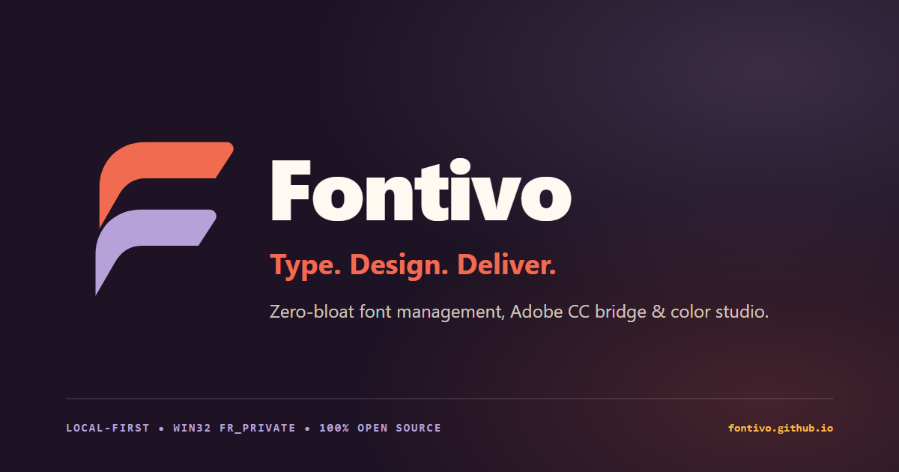

<div align="center">
  <a href="https://github.com/Ahmedfahmy8308/Fontivo">
    
  </a>
  <br><br>
  <h1>Fontivo Fonts — Official Typography Distribution Hub</h1>
</div>

[](https://github.com/Ahmedfahmy8308/Fontivo-Fonts/releases/tag/v1.0.2)
[](#typography-collection)
[](#typography-collection)
[](#distribution-packages)
[](#distribution-packages)
[](#licensing)

The official high-performance typography distribution and content delivery engine powering the **[Fontivo](https://github.com/Ahmedfahmy8308/Fontivo)** Creative Identity & Asset Management ecosystem — the unified desktop platform for managing brand identities, color palettes, ASE swatch exchanges, project workspaces, and live RAM typography activation.

---

## Typography Collection

Fontivo Fonts provides an extensively curated, validated library of **10,388 font files** grouped into **4,076 typographic families**, optimized for graphic designers, UI/UX engineers, and desktop publishing workflows:

| Script / Category | Fonts | Description & Highlights |
| :--- | :---: | :--- |
| **Latin** | 6,663 | Modern display, workhorse sans-serif, classic editorial serif, slab, geometric, and decorative typefaces. |
| **Urdu (Arabic Script)** | 1,533 | Authentic Nastaliq, Naskh, and modern Arabic-script calligraphic typesetting suites. |
| **Persian (Arabic Script)** | 1,249 | Comprehensive Nastaleeq, Shekasteh, and contemporary Arabic-script digital UI typography. |
| **Arabic** | 943 | Kufi, Naskh, Thuluth, Ruq'ah, Diwani, and contemporary Arabic brand typography. |
| **Total** | **10,388** | **4,076 Typographic Families** |

---

## Distribution Architecture

Fontivo employs a **decoupled, content-addressed delivery architecture**. Font binaries are distributed in **15 deterministic, highly-compressed packages** hosted on GitHub Releases, while repository metadata remains lightweight (< 15 MB) for instant synchronization.

```
                           +--------------------------------+
                           |  Fontivo-Fonts (Git Repo)      |
                           |  Manifests, Metadata & Tooling |
                           +---------------+----------------+
                                           |
                               Reads Manifest | (SHA-256 Verified)
                                           v
                           +--------------------------------+
                           |  GitHub Releases (v1.0.2)      |
                           |  15 Deterministic Archives     | (~510 MB Total)
                           +---------------+----------------+
                                           |
                              On-Demand    | Package Download
                                           v
                           +--------------------------------+
                           |  Fontivo Desktop Application   |
                           |  Instant Activation & Caching  |
                           +--------------------------------+
```

### Key Architectural Advantages
- **On-Demand Package Streaming**: The Fontivo desktop application downloads only the packages requested by the user rather than forcing a monolithic multi-gigabyte download.
- **Deterministic Compression**: All packages are built with canonical sorting and fixed timestamps, guaranteeing identical SHA-256 checksums across rebuilds.
- **Content-Addressed Cache**: Every font file is hashed and verified upon extraction, completely eliminating corrupt or tampered font files.

---

## Distribution Packages

The collection is partitioned into 15 independent distribution packages (`~611 MB` total compressed size):

| Package Archive | Fonts | Category Focus |
| :--- | :---: | :--- |
| `fontivo-essential-001.zip` | 943 | Arabic Typography (Classic, Modern, Kufi, Naskh) |
| `fontivo-essential-002.zip` | 487 | Latin Workhorses (Sans & Body Text) |
| `fontivo-essential-003.zip` | 1,334 | Latin Typography (Comprehensive Display & Sans) |
| `fontivo-essential-004.zip` | 1,438 | Latin Typography (Contemporary & Editorial) |
| `fontivo-essential-005.zip` | 1,241 | Latin Display & Geometric |
| `fontivo-essential-006.zip` | 288 | Latin Classic & Modern Serif |
| `fontivo-essential-007.zip` | 325 | Latin Modern & Editorial |
| `fontivo-essential-008.zip` | 835 | Latin Extended & Headline |
| `fontivo-essential-009.zip` | 802 | Latin Decorative, Script & Brush |
| `fontivo-essential-010.zip` | 1,162 | Urdu Nastaliq & Latin Typography |
| `fontivo-essential-011.zip` | 251 | Urdu & Persian Typographic Suites |
| `fontivo-essential-012.zip` | 436 | Persian, Indic & Hebrew Typography |
| `fontivo-essential-013.zip` | 272 | Multilingual Suites & Global Typography |
| `fontivo-essential-014.zip` | 538 | Artistic & Specialized Display Typography |
| `fontivo-essential-015.zip` | 36 | Symbols, Icons, Dingbats & Ornaments |
| **Total** | **10,388** | **Curated Production Typography Collection (510.0 MB)** |

All packages are available under [GitHub Releases](https://github.com/Ahmedfahmy8308/Fontivo-Fonts/releases/tag/v1.0.0).

---

## Directory Structure

```
Fontivo-Fonts/
├── Build/                     # Generated deterministic package archives (001..015)
├── Library/                   # Local font hierarchy by script and family
│   ├── Arabic/Families/...
│   ├── Latin/Families/...
│   ├── Urdu/Families/...
│   ├── Persian/Families/...
│   ├── Hebrew/Families/...
│   ├── Indic/Families/...
│   └── Unclassified/Families/...
├── Manifests/
│   └── manifest.json          # Canonical distribution manifest & package registry
├── Metadata/
│   ├── collections.json       # Collection definitions
│   ├── packages.json          # Package membership mappings
│   ├── fonts.json             # OpenType metadata & license registry
│   └── families.json          # Family grouping registry
├── Scripts/                   # Repository tooling & automation
│   ├── build.py               # Incremental package builder
│   ├── update.py              # CLI for adding/removing fonts
│   ├── scan.py                # Library integrity scanner
│   ├── sync-app-cache.py      # App cache synchronization tool
│   └── publish-release.py     # Release verification & publishing tool
├── State/
│   └── build-state.json       # Persistent build state & tombstones
├── .gitignore
└── README.md
```

---

## Maintainer Tooling

Management scripts are located in `Scripts/` and execute from the repository root:

### Adding Fonts
Validates OpenType tables, extracts family metadata, places files into the appropriate `Library/` directory, and rebuilds only the affected archive:
```bash
python Scripts/update.py add path/to/font.ttf --category Arabic
python Scripts/update.py add path/to/font.otf --category Latin --family "BrandFamily"
```

### Removing Fonts
Removes the physical file from `Library/`, records an immutable tombstone in `State/build-state.json`, and rebuilds only the affected package:
```bash
python Scripts/update.py remove "FontName.ttf"
```

### Verifying Library Integrity
Verifies that all 10,388 fonts in `Library/` and all 15 package archives in `Build/` physically match recorded SHA-256 states:
```bash
python Scripts/scan.py
```

### Checking Release Packages
Validates all 15 distribution archives against `Manifests/manifest.json`:
```bash
python Scripts/publish-release.py --check
```

---

## Licensing

The font files in this collection are licensed under their respective free and open-source licenses, primarily:
- **SIL Open Font License (OFL-1.1)**
- **Apache License 2.0**
- **Ubuntu Font License (UFL)**
- **Public Domain / Creative Commons (CC0)**

Individual font licensing details, designer credits, and copyright notices are indexed in `Metadata/fonts.json`.

The tooling, scripts, and build infrastructure in this repository are licensed under the **MIT License**.
